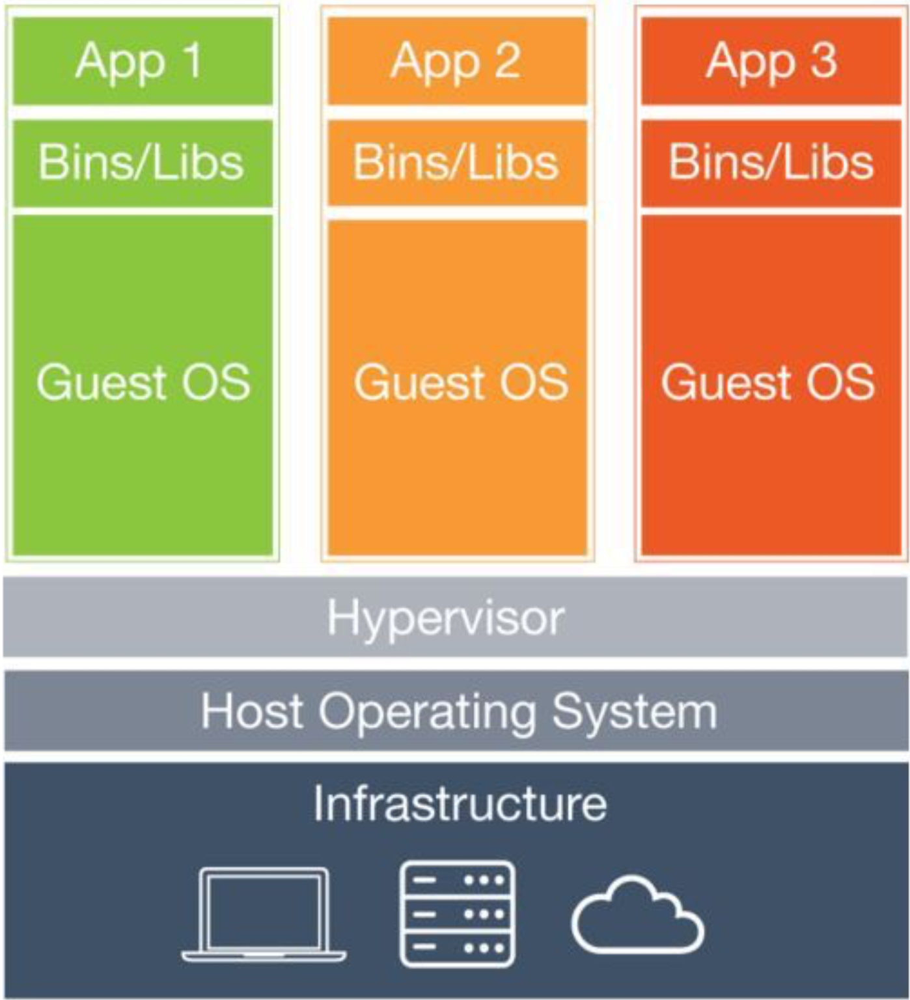
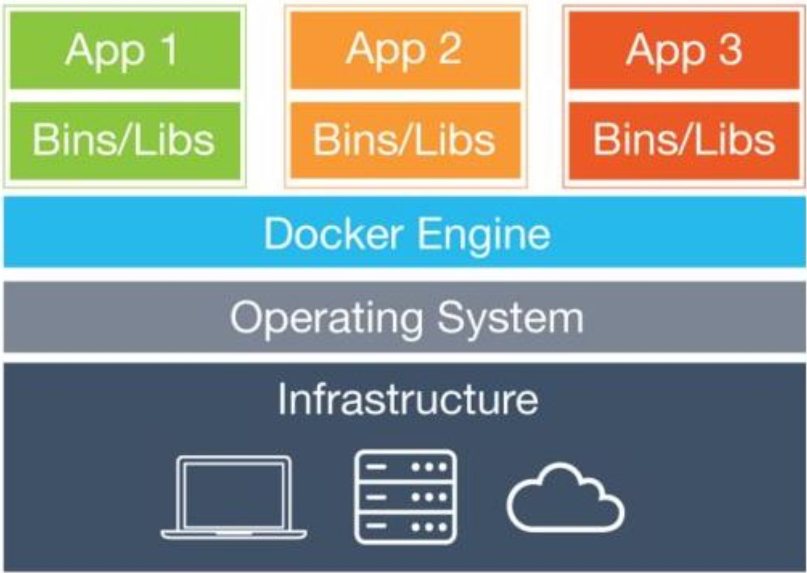

*Guide last updated: October 31, 2023*

We have created a Docker image for the students of CS 2110 that contains all of the tools that they will need throughout this course. The image itself is hosted on [Docker Hub](https://hub.docker.com/r/gtcs2110/cs2110docker/){:target="_blank"}, but we have developed a script for you to use so you don't need to worry about that.

### **Note: We have two variations of CS 2110 Docker images for this course. Please select the guide that is applicable to your section of the course!**
- [C Docker container guide](c-guide/c-guide.md) (**Fall 2023 with Conte, Gupta, Adams**) 
- [noVNC Docker container guide](novnc-guide/novnc-guide.md)

If you run into any issues, please take a look at [Common Issues](common-issues.md), and also don't hesitate to ask one of your TAs for help!

# Optional reading (for the curious)
## What even is Docker?
I'm so glad you asked. In order to answer this question we have to go back in time:

## Physical Servers
Back in the stone age, when application developers wanted to deploy their application, they first had to procure a server. These servers were very expensive, and for various reasons they could run a very small number of applications on each server. They also had to make sure their servers were powerful enough to handle a high load, so at times of lower load, there were a lot of wasted resources that were not doing anything. Monsters stalked the night, storms filled the skies, pestilence ran through the streets, and death was common. This obviously was a pretty big problem.

## Virtual Machines
In order to help minimize the amount of resources that were wasted on servers, people started using "Virtual Machines." Virtual machines are essentially computers within computers. First, you start with a physical server and install an operating system. On top of this operating system, you install something called a "hypervisor." A hypervisor is a type of virtualization technology that allows us to emulate the hardware of a computer and install more operating systems on top of the main operating system. These guest operating systems are called virtual machines. With virtual machines, we can have one physical server and run multiple operating systems, which means that we can run multiple applications and thus not waste a ton of space. Problem solved! Here is a picture to illustrate how virtual machines work:
{:.centered}

## What now?
So we have fixed the problem of wasted resources. Time to kick back and put our feet up and be happy with everything we've accomplished, right? Well, if you take a look at the picture, guest operating systems are duplicated multiple times and taking up a bunch of space. Creating entire guest operating systems is incredibly wasteful. If you think about it, there is a ton of stuff that is duplicated. Each guest operating system has copies of the same base files and programs that make it up. In addition, emulating multiple operating systems takes a TON of system resources, which does not leave much for the applications themselves. So while we have solved the problem of having extra resources that are not utilized, we now have the opposite problem. We are using a ton of resources to do the exact same stuff multiple times. What if we could redirect these resources so that the applications themselves could have more to work with?

## Containers
A few years after the concept of virtual machines was developed, some very smart people out there came up with the concept of "containerization." Containerization is another type of virtualization, but instead of making multiple guest operating systems on top of an existing operating systems like virtual machines do, containerization divides the resources of the host operating system. Containerization involves creating "containers," which are essentially sandboxes for applications to run in. By sandbox, I mean that it utilizes resources of the host operating system, but cannot impact anything outside of it. This provides a safe space for applications to run in. Each container gets its own chunk of everything that it could need from the host operating system---file system, system tools, network stack, etc.

## Docker
Docker is an open source project that began in 2010 with the goal of providing abstraction to containers. Using Docker, application developers are able to quickly and easily containerize their applications. In order to use Docker, the host machine runs the Docker Engine, which handles the management and creation of containers. Here is a picture showing how containerization with Docker works (compare this to the Virtual Machine Picture):

{:.centered}

As you can see from the image, we no longer have to make multiple copies of the same operating system to run multiple applications. Instead, everything shares the resources of the host operating system. Docker is designed to be run on Linux machines (since containers are dependent on the operating system they are running on), but they also provide solutions that will run on Windows and Linux using very very lightweight virtual machines.

## CONTAINERS ARE STATELESS
There is one key component that we can not stress enough (and will continue to remind you of). Containers are stateless. They are designed so that they can be easily destroyed and recreated (which helps make them so lightweight). This means that any files saved inside a container or any changes made to it will be erased the second that the container is terminated. If you are working on something inside a container, you have to make sure you save it outside of the container before shutting the container down.

## Why should I care about Docker?
Good question! Previously, we had our students install virtual machines in order to complete their assignments for this class. It worked fine for some, but many had at least one of the following issues:
-   VMs crashing all the time
-   VMs not connecting to internet
-   VMs running incredibly slow
-   Issues installing tools that the class needs
-   Random issues that only apply to a single student and can only be solved by deleting the VM and creating a new one (which takes forever)
-   A ton more

As a result, we are using Docker to mimic a VM. This isn't precisely how Docker is meant to be used, but it will provide a lot of benefits including:
-   Serious performance improvements
-   No networking issues because you won't use the network with it
-   Seamless integration with your host operating machine
-   Comes pre-installed with all the tools that you will need
-   The TAs can release updates/fixes mid-semester without any action on the students' part
-   Since containers are stateless, if you have any problems, all you have to do is delete it and create a new one, which takes about 5 seconds
