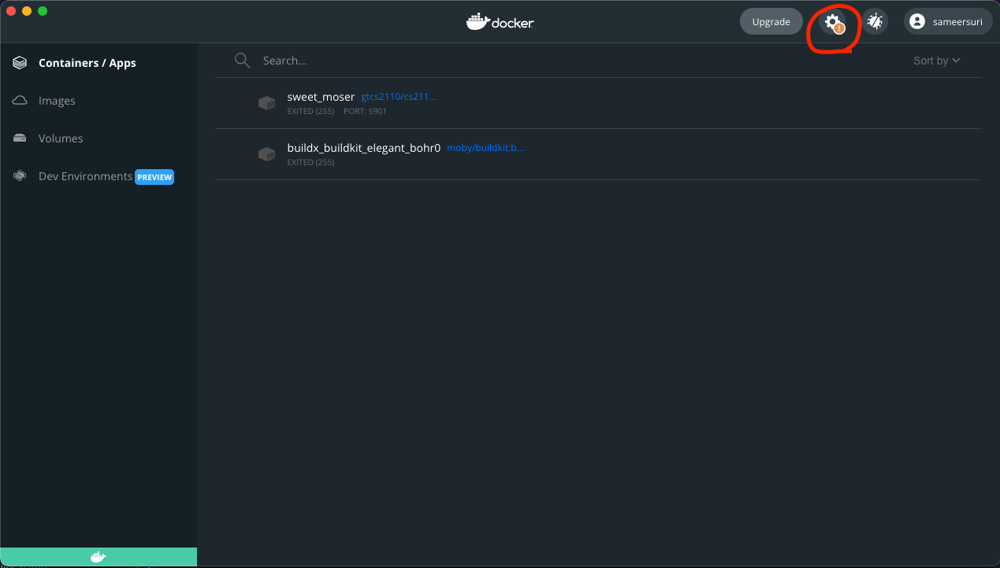
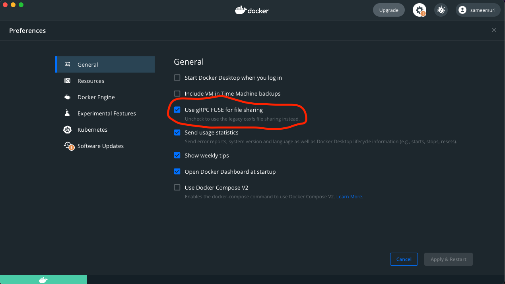

First, determine if your Mac is using an Intel (x86) or Apple silicon (ARM) processor.
- [How do I know if my Mac uses x86 or Apple silicon?](https://www.makeuseof.com/how-to-find-out-if-your-mac-uses-intel-or-apple-silicon/){:target="_blank"}

### Apple silicon (M1 / ARM Mac)
Follow the instructions for the for the M1 here: <https://docs.docker.com/docker-for-mac/apple-silicon/>{:target="_blank"}. 

Note that support for Docker on Apple silicon is relatively recent, although we have managed to mitigate most issues, it is possible that you will still encounter some. If you run into strange issues during normal operation, please let the TAs know.

### Intel processor (x86 Mac)
If your Mac is a 2010 model or newer and is running macOS El Capitan 10.11 or newer, you can head over to Docker's website at the following link and follow the instructions to install the Community Edition of Docker: <https://docs.docker.com/docker-for-mac/install/>{:target="_blank"}

If your Mac is older than 2010, please post privately on Ed Discussion / Piazza and we can discuss a solution.

## Running the Docker container
1. Make 100% sure you've rebooted your computer after installation before proceeding.
2. Open the "Docker Desktop" application. Docker will start up, and the whale icon should eventually either turn green (yay it worked!) or red (error). If it comes up red, please ask a TA for help.
3. There are some bugs with new features in macOS that can cause your files to not show up correctly in Docker. Please go to the settings inside Docker and **disable gRPC FUSE** (the box should be unchecked). This only needs to be done once.
    {:.centered}
    {:.centered}
4. After Docker has started, open the Terminal application, and use `cd` to navigate to the directory in which you put the `cs2110docker.sh` script.
    * See [Navigating the Terminal](navigating-terminal.md){:target="_blank"} if you are not familiar with how to do this.
5. Run the following command to give the Docker script permission to run (you only need to do this the first time):
    * `sudo chmod +x cs2110docker.sh`
    * Enter your password if prompted.
6. Run the script by typing `./cs2110docker.sh`.
    * This may take a moment if it is your first time running the script, but if everything goes as planned, you should see eventually see the message `Successfully launched CS 2110 Docker container.`

Installation is done, and you have the container up and running! Finally, check out [Using the CS 2110 Docker Container](c-guide/using-docker-c.md).