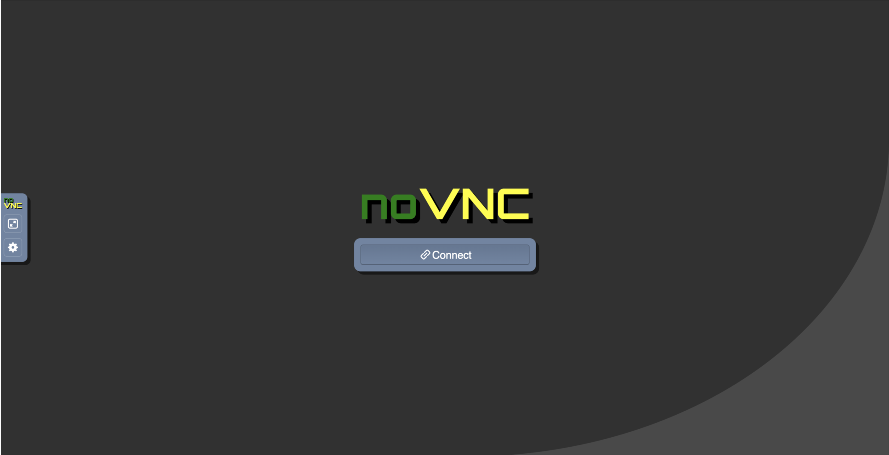
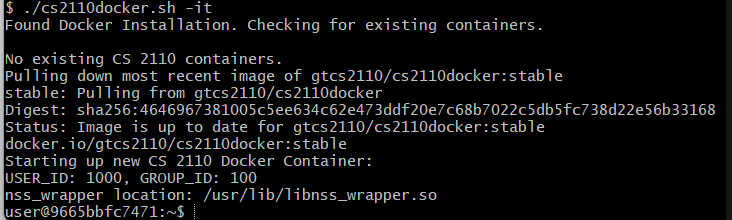
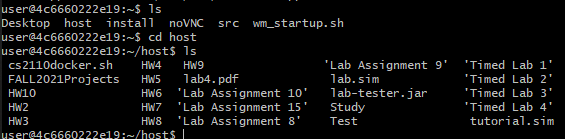

There are two ways to run the Docker image---using a browser or using a VNC client. When you ran the `cs2110docker.sh` script, the last line outputted a URL, which should be something along the lines of:

    http://127.0.0.1:6901/

This URL gives you access to the container from a web browser, which is the easiest way to use it. Open up your browser and go to the URL. You should see this page:

{:.centered}

Click connect.

If you don't want to use the browser, you can also connect using any VNC client. In order to connect, use the same base URL as the browser (`127.0.0.1`), but instead use port **5901**.

That's it! You should be up and running with a desktop in your browser!

If you open up the File Manager inside the Docker container and look along the left, you should see a device called `host`, whcih contains all of the same files and folders as the folder containing `cs2110docker.sh`. For instance, if `cs2110docker.sh` is stored in Desktop, then you should see all the contents of your Desktop folder inside `host`. The folder has been *mounted* inside the container, meaning updating the files on your computer will be reflected in the container and vice versa.

**When you are doing your work, you should edit all of you files in this folder on your host machine. Then, use the Docker container to run the code. DO NOT SAVE FILES INSIDE THE CONTAINER ANYWHERE EXCEPT IN THE `host` FOLDER. THEY WILL DISAPPEAR. PLEASE DON'T DO IT. PLEASE.**

You will not get extensions on projects because you saved stuff where you should not have. We are making this very clear up front. Don't do it.

When you are done using the container, you can shut it down by running
    
    ./cs2110docker.sh stop

**Note for Windows users**: Docker Desktop on Windows uses a WSL 2 virtual machine to run the Docker container. Stopping the container will not stop the VM, which can eat up a lot of RAM. Therefore, you may also want to run the following command after stopping the container and/or [create a .wslconfig file](common-issues.md#wslconfig){:target="_blank"}.:

    wsl --shutdown

If you are interested in running the container in the shell (no
graphics), you can run:

    ./cs2110docker.sh -it

You should then see something like this:
{:.centered}

And then you can move around and interact with the Docker container like in any other termninal: 
{:.centered}

## Wrap up

That's about all that there is to the CS 2110 Docker container setup. If you have any questions or issues, please post on Ed Discussion / Piazza **under the Docker folder**, so we can sort through Docker questions efficiently.

If there is no Docker folder for your section, then please post any Docker questions under "General".